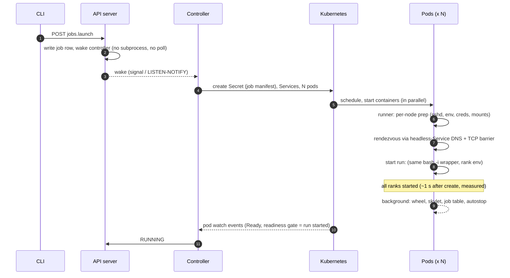

# Self-Starting Pods: fast multi-node managed-job launch on Kubernetes

Design proposal from the launch-latency investigation, 2026-10-15, SkyPilot master @ 9397155e0.
Evidence tags:
- **[V]** verified from captured timestamps or logs (`bench/runs/`);
- **[C]** read in code;
- **[H]** hypothesis or estimate.

Supporting material:
- `bench/ANALYSIS.md`: the measured diagnosis.
- `bench/PLAN.md`: the incremental fix plan.
- `bench/design/`: three team notes on the control plane, bootstrap and executor.
- `bench/proto/`: the prototype and its results.

## 0. Summary

**Today.** `sky jobs launch` of a 4-node job on Kind takes **54.5 s** (warm) until every rank's `run:` has started [V].
- The pods themselves are Ready **2.4–2.7 s after SkyPilot creates them** [V].
- The other ~48 s are SkyPilot's architecture, not slow steps: Kubernetes pods are treated as VMs. Once they are Ready, the API server host drives a serial bootstrap of about a dozen `kubectl exec` round trips, most of which start a cold Python process that imports `sky`. It then forms a Ray cluster and runs a Ray driver to start the ranks.
- The control plane in front of that is built from polls and subprocesses.

**Proposal.** For managed jobs on Kubernetes, which run on single-use clusters, **make the pod spec carry the job and let the pods start it themselves**.
- Everything known at creation time goes into the pod spec. Peer addresses are discovered through the headless Services SkyPilot already creates.
- A small runner in each pod does the per-node preparation, waits at a rendezvous and starts `run:`.
- SkyPilot's runtime (wheel, skylet, Ray) comes up in the background, off the critical path.
- The host watches pod events instead of driving the bootstrap.
- The control plane in front becomes event-driven.

**Prototype.** I built this on the same Kind cluster with raw pods, using SkyPilot's own pod spec (same image, resources, env and Services), with only the container command replaced. All 4 ranks start **1.0–1.1 s after pod creation** (`IfNotPresent`), or **2.7–3.8 s** with SkyPilot's current `imagePullPolicy: Always`. SkyPilot today takes **47.7–47.9 s** for the same window [V].

Keeping Ray as the gang executor, even with every Ray fix applied and the head submitting its own driver, takes **12.2–14.8 s** for that window [V]. Ray alone costs about 11 s after the pods are Ready.

| Design | t0 → pods created | Pod create → slowest rank | Headline |
|---|---|---|---|
| Today | 6.4–7.1 [V] (7.5 mean with claim jitter) | 47.7–47.9 [V] | **54.1–55.0** [V] |
| Incremental fixes (PLAN.md, host-driven, Ray kept) | ~5 [H] | ~20–24 [H] | **24–29** [H] |
| Self-starting pods, Ray as gang executor | 2.4–3.6 [H] | 12.2–14.8 [V proto] | **15–19** [H] |
| **Self-starting pods, Ray-free gang** | 2.4–3.6 [H] | 1.0–3.8 [V proto] + ≤1 in-pod prep [H] | **4–8** [H] |
| Same, without the control-plane work | 6.4–7.5 [V] | as above | **8–12** [H] |

Read the last two rows as follows:
- **Measured:** the pod-side window. The prototype ran it, it is not an estimate, and it is the part that was 83% of the time.
- **Estimated:** the control-plane savings come from the trace (Team A, `design/frontend.md`).
- **Not in the prototype:** the in-pod preparation that the real path still needs before `run:` (sshd, user-env check, ulimit, credentials). That work is under a second on the default image [H], so it carries a 1 s allowance.

## 1. Diagnosis: four structural causes

| # | Cause | Seconds today [V] | Why a per-step fix doesn't remove it |
|---|---|---|---|
| S1 | **Host-driven serial bootstrap.** After pods are Ready, the API server host runs file mounts, runtime setup, skylet start, autostop, `add_job`, upload and queue as sequential `kubectl exec`s. Each exec that runs SkyPilot code starts a cold Python process that imports `sky` (2.1–2.9 s warm, 8–9.5 s cold [V §5.10]). | 14.8 (P1, P2, P4–P8) + 1.2 "Ready noticed" | Pipelining and slimmer imports shrink it (PLAN W4/W6). The structure still pays one host-to-pod round trip and one interpreter start per step, and nothing can start until the host gets to it. |
| S2 | **Ray on the critical path.** The cluster forms after the PyPI install, `ray stop` and dashboard startup. The host polls `ray status` (itself a 2.4 s CLI). The driver then waits on a placement group and spawns Ray workers that import `sky`. | 20.7 (P3) + 8.5 (driver to slowest rank) | The prototype with every Ray fix still spends **8.8–12.6 s** from Ready to the slowest rank [V proto]. That is Ray's own floor on this hardware. |
| S3 | **Poll and subprocess control plane.** The `jobs.launch` request spawns a scheduler subprocess that imports `sky` again (~1.9 s). The controller claims work on a 10 s poll (0–5.6 s, mean ~2.1 s over 8 runs). The CLI imports all of `sky` (1.33 s). | 6.4–7.1 before pod create | Each hop is small, but there are 11 hops (`design/frontend.md` §1). |
| S4 | **An unfinished default image** (`Dockerfile_k8s`, SkyPilot's own). Every pod reinstalls `skypilot` from PyPI (5.6 s before Ray on the head) and installs `setuptools<70`/`click<8.3` before Ray can start (`constants.py:404`). About 400 `sky` and about 420 Ray `.pyc` files are compiled at runtime. `imagePullPolicy: Always` serializes container starts by ~0.5 s per pod. | ~5–9 spread over S1/S2 | Fixable in the image. The self-starting design doesn't depend on it. |

S1 and S2 are 45 of the 54.5 s and come from one decision: the cluster is assembled from the outside, after the fact. The proposal reverses that.

## 2. Design: the pod spec is the job

### 2.1 Principle
- **Push, don't pull.** Put everything SkyPilot knows at pod-creation time into the pod spec: the scripts, envs, node count, peer names, attempt id and storage commands.
- **Discover only what can't be known in advance**, the peer IPs, through the per-pod headless Services the template already creates (`kubernetes-ray.yml.j2:275-315`) [C].
- **Keep only the user's work on the critical path**: per-node preparation, an all-node barrier, and `run:`. Everything SkyPilot needs for itself (wheel, skylet, job table, autostop, Ray) starts in the background.
- **The host observes instead of driving**: pod watch events, plus a status file read with a non-Python `kubectl exec cat` (0.13 s [V §5.10]).

### 2.2 The new critical path

### 2.3 What moves where
Team B classified all 26 steps between pod creation and `run:` (`design/push_bootstrap.md` §1):
- **(a) Stays on the critical path: 5 steps.** The user's `setup:` with its all-node success barrier, the gang and rank mapping, the per-rank wrapper, and log capture.
- **(b) Must precede `run:` but now runs in-pod, in parallel: 8 steps.** sshd, user-env check, env setup, ulimit/FUSE config, credentials, and workdir, file-mount and storage-mount fetches. Managed jobs already turn local workdirs and mounts into bucket URLs (`controller_utils.py:1077-1160`) [C], so the pods only fetch.
- **(c) Leaves the critical path: 13 steps.** The PyPI install, Ray patches, `ray start`, the wheel, skylet, autostop, `add_job`, driver upload, queue, `set_job_started`, and the Ray-ready poll.

### 2.4 Rendezvous and the setup barrier
- **R1, everyone exists.** Each runner resolves `<cluster>-head` and `<cluster>-worker<i>` (`.<ns>.svc.cluster.local`). Rank is the pod's ordinal. `SKYPILOT_NODE_IPS` is the IP list in rank order, the same order `check_ip` produces today (`task_codegen.py:552-575`) [C].
- **R2, everyone prepared** (only when `setup:` or MOUNT storage exists). After its prep succeeds, each runner listens on a rendezvous port, and peers connect-poll (the template already uses this `/dev/tcp` idiom for the head at `j2:1530`). A node whose prep fails never listens, so no node starts `run:`. That preserves today's rule: if setup fails anywhere, `run:` starts nowhere (`task_codegen.py:477-543`) [C].
- **Measured:** the prototype implements R1 and R2. Ranks start 0.05–0.13 s after the last pod becomes Ready [V proto].
- **Caveat:** Kind's CoreDNS has caching disabled for `cluster.local` [V]. Clusters with NodeLocal DNSCache can cache the "no endpoints yet" answer for up to ~30 s [H]. Fall back to an API watch on the pods, since the pod service account already has namespace access [V].

### 2.5 Observing the job
- **Status.** The runner writes `/tmp/sky_job/{status,exit_codes,start_ts,end_ts}`. A `ManagedJobRuntime` adapter (`sky/jobs/runtime.py:145-260`) [C] reads it with `kubectl exec cat` instead of today's codegen exec, which imports `sky` for 2.1–2.7 s per call [V].
- **RUNNING.** A pod readiness gate or probe on "run started" turns RUNNING into a watch event. This also removes the four confirmation execs that make RUNNING lag 6.6 s today (PLAN W8) [V].
- **Logs.** The runner tees each rank to the same `tasks/<rank>-<node>.log` path. The adapter's `tail_logs`/`download_logs` read those per pod. Once the background skylet is up, the existing head-side `run.log` path takes over.
- **Exit.** Because the cluster is single-use, the job's end can be the container's end. Kubernetes then records the exit code, and the controller sees it from the watch.

### 2.6 It plugs into extension points SkyPilot already has
#9510 (May 2026) added exactly the hooks this needs [C, verified at 9397155e0]:
- `ProvisionRuntimeMetadata` (`sky/provision/common.py:90-124`) has `runtime_setup_done`, `workdir_synced`, `file_mounts_synced`, `setup_done`, `run_started`, `has_ray`, `has_skylet` and `has_job_queue`. `has_job_queue=False` is documented as "single-use clusters where the job is baked into the provisioned runtime itself".
- The backend honours these flags: runtime setup at `cloud_vm_ray_backend.py:3725`, setup at `:4144`, and exec at `:4688` ("Skipping run: provisioner reported run already started").
- The provisioner registry with `TemplateOverrideFn` is in `sky/provision/__init__.py:68-126`.
- The `ManagedJobRuntime` protocol covers `get_job_status`, `get_exit_codes`, `tail_logs`, `download_logs` and `cleanup`.

So a Kubernetes fast-start path is a provisioner variant plus a runtime adapter, not a backend rewrite.

### 2.7 Scope and fallback
- **Eligible:**
  - managed jobs on Kubernetes that get a fresh, single-use cluster;
  - non-pool and non-HA;
  - a job manifest under ~800 KB, with bucket-backed mounts.
- **Not eligible, so they keep today's path unchanged:**
  - `sky launch` clusters, which take later `sky exec`s;
  - pools, which reuse clusters and need the job queue;
  - controller clusters;
  - TPU and Slurm.

  Old clusters stay on the old path: the codegen choice branches on the handle's metadata, never on the cloud (`design/executor.md` §5) [C].
- **Single-use is what makes this tractable.** One job per cluster means there's no multi-job queue and no resource ledger to rebuild. Those are the two hardest things Ray does today (`design/executor.md` R8/R9) [C].

## 3. Control plane: make the front end event-driven
Once the pod side takes ~1–4 s, the 6.4–7.5 s before pod creation is most of what's left. Team A's decomposition and options are in `design/frontend.md`:

| Move | Saving | Risk |
|---|---|---|
| Submit in-process in consolidation mode. Drop the scheduler subprocess and the 5 local rsyncs. | −2.0 to −2.3 s [V window, H fix] | Low. Gate on `is_consolidation_mode()`. |
| Event-driven claim: local signal; `LISTEN/NOTIFY` with Postgres. Keep the poll as fallback. | mean −2 s, tail −5.6 s [V distribution] | Medium. Multi-replica leader routing. |
| Pre-resolve the plan at submit. Skip the optimizer when there is one feasible infra. | −0.5 to −1 s [H] | Low. Not on recovery. |
| Slim CLI: lazy `sky/__init__` (shared with on-pod import work) | −0.9 to −1.1 s [H] | Medium. Public import surface. |
| Parallel Service creates | −0.3 s [V] | None. |
| Speculative pod creation at submit | −4 s typical [H] | High. It bypasses admission, so do it only if needed. |

Projected pod creation at **~2.4–3.6 s** after t0 instead of 6.4–7.5 s [H].

## 4. Alternatives considered

| Option | Headline | Verdict |
|---|---|---|
| Incremental fixes on today's architecture (PLAN.md W1–W8) | 24–29 s [H] | Do the no-regret parts anyway: they help every cluster type, including `sky launch`. They don't reach "significantly faster". |
| Self-starting pods that keep Ray as the gang executor | 15–19 s [H], pod side measured | Lower risk: no new executor. But Ray's own startup is ~11 s of the remaining time, measured on the prototype. |
| **Self-starting pods, Ray-free gang (proposal)** | **4–8 s** [H], pod side measured | Biggest change, but it rides on existing extension points and is scoped to single-use clusters. |
| Warm pools (`sky jobs pool`, pre-created workers) | front end + job submission, ~5–10 s [H] | Complementary. It trades idle capacity for latency. Multi-node pools aren't blocked in code, but nothing tests them (`design/frontend.md` §3); the recipe is in `design/pool_experiment.md`. A job on a pool still pays the exec chain and Ray driver unless those are also fixed. |
| Kubernetes-native job objects (Indexed Job, or JobSet where installed) | similar to the proposal | Same contract: index, stable hostnames, gang. JobSet isn't installed everywhere, and SkyPilot already manages raw pods and recovery. Borrow the contract, keep the pods. |

## 5. Evidence: the prototype
**Method** (`bench/proto/`):
- `proto.py` builds N pods plus N headless Services from SkyPilot's own trial-3 pod spec: same image (`skypilot:202607240748`), requests, env, `/dev/shm` and service account. Only the container command changes.
- `run_proto.sh` takes t0 right before `kubectl create`, records host-time pod watch events, reads each rank's `started at` line, then deletes everything and waits until it's gone.
- Pods share the host clock, as in the main harness.
- Two modes:
  - `selfstart`: R1 plus a TCP barrier, then `run:`.
  - `rayfast`: Ray started at container start with no `ray stop` and no dashboard, the same `setuptools`/`click` fix SkyPilot applies, and a slim placement-group driver submitted by the head itself.

**Results, N=4, warm image [V]** (`bench/proto/results.csv`):

| Mode | Pull policy | Trials | Pods all Ready | Slowest rank | Ready → slowest rank |
|---|---|---|---|---|---|
| SkyPilot today | Always | trial2, trial3 | 2.35–2.69 | 47.65–47.88 | 45.2 |
| selfstart | Always | 3 | 2.57–3.78 | 2.68–3.84 | 0.05–0.11 |
| selfstart | IfNotPresent | 3 | 0.91–0.94 | 0.98–1.06 | 0.07–0.13 |
| rayfast | Always | 3 | 2.41–5.01 | 12.65–14.83 | 8.8–11.8 |
| rayfast | IfNotPresent | 2 | 0.89–0.91 | 12.17–13.49 | 11.3–12.6 |

All columns are seconds after the create call.

The Ray-kept breakdown (rf1):
- The head's `ray start` takes 7.6 s, and workers can join only after its port opens.
- The workers' `ray start` takes another ~5.8 s.
- The placement group is ready 3.6 s after `ray.init`, and the ranks start under 0.1 s after that.

**Scaling, N=8** (0.5-CPU requests, since 8 × 1 CPU doesn't fit the single node): see §5.1.

**What the prototype leaves out:**
- SkyPilot's in-pod prep: sshd, user-env check, credentials, ulimit. That's under a second on the default image [H], hence the 1 s allowance in §0.
- The job manifest delivery: a Secret volume mount, which is part of pod startup [H].

**Limits of this environment:**
- one Kind node with 8 cores and a warm image;
- N=4 and N=8 only;
- the cold path, a first image pull of 23.7 s [V], is a separate problem (§6).

### 5.1 Scaling to N=8
All pods request 0.5 CPU, because 8 × 1 CPU doesn't fit the single node [V].

| Mode | Pull policy | N=4 slowest rank | N=8 slowest rank | Container-start spacing |
|---|---|---|---|---|
| selfstart | IfNotPresent | 0.98–1.06 | 1.33–1.37 (2 trials) | 0.01–0.10 s |
| selfstart | Always | 2.68–3.84 | 4.72 | 0.31–0.60 s per pod, serialized |
| rayfast | IfNotPresent | 12.17–13.49 | 18.65 | 0.02–0.09 s |

- **Self-start.** It is nearly flat in N. Ranks start 0.07–0.10 s after the last pod is Ready, with a rank spread of 0.03–0.04 s [V].
- **`Always` pull policy.** It adds about 0.5 s × (N−1), because the kubelet serializes the registry checks [V]. This penalty grows with N, so it's worth fixing on any path.
- **Ray kept.** It grows with N here, but that is confounded: eight `ray start`s contend for one 8-core node. On a real multi-node cluster each node has its own CPU, so this row overstates Ray's N-scaling [H].

## 6. Costs we said we'd accept, re-evaluated

| Cost | Earlier stance | Now |
|---|---|---|
| Runtime bytecode compile (~400 `sky` + ~420 Ray `.pyc` per pod) | Accept: workloads and images vary | **Moot on the fast path**: no `sky` or Ray import runs before `run:`. For the Ray path, SkyPilot owns the default image, so precompile there (`Dockerfile_k8s`); custom images compile in the background. |
| `imagePullPolicy: Always` | Not examined | **~0.5 s per pod, serialized by the kubelet** [V proto]: create → all Ready is 2.6–3.8 s with Always versus 0.9 s with IfNotPresent at N=4, and 4.6 s versus 1.3 s at N=8. The default image tag is a timestamp (`202607240748`), so `IfNotPresent` is safe for it. Keep `Always` only for mutable tags such as `:latest`. |
| `setuptools<70` / `click<8.3` installed on every pod before Ray | Not seen | Bake it into the default image. Without it, the raylet dies with the dashboard agent (`No module named 'pkg_resources'`) [V proto]. |
| PyPI reinstall of `skypilot` on every pod (5.6 s before Ray on the head) | Fix via a deps-only install (W5) | Off the critical path on the fast path, and still worth W5 for the old path. |
| Cold first pull (23.7 s) | Out of scope | Still mostly cluster-level. SkyPilot could pre-pull the default image when it sets up a context (`sky local up`, `sky check`) [H]. |

## 7. Risks and what has to stay true
From `design/push_bootstrap.md` §6 and `design/executor.md` §5:
1. **Setup barrier without a coordinator.** R2 must be exactly "no `run:` anywhere if any setup failed", with timeouts and hostNetwork port handling.
2. **State contract with the controller.** `FAILED_SETUP` vs `FAILED` vs a retryable launch failure, RUNNING detection, exit codes and logs, all before the job table or skylet exist. The `ManagedJobRuntime` adapter carries this.
3. **No double run.** A re-created pod must not run the job again. Use a fresh attempt id per launch, an in-pod started marker, `restartPolicy: Never`, and exclude HA.
4. **Env parity.** Ray currently supplies `CUDA_VISIBLE_DEVICES` (the whole-node grant), `OMP_NUM_THREADS` and others to `run:`. The runner must synthesize them. The rank order must match `check_ip` for N ≥ 11 (ordinal versus lexicographic).
5. **Custom images.** The runner must be bash plus stdlib Python, or a static binary, because a user image may have no Python.
6. **Secrets.** The job manifest in a Secret lands in etcd. Today secrets already reach the pod's disk (`/tmp/sky_app_*`), so the new exposure is `get secrets` access in the namespace.

## 8. Rollout

| Step | What | Expected headline | Risk |
|---|---|---|---|
| 0, no-regret (all clusters) | Image: setuptools/click, bytecode, `IfNotPresent` for the pinned default image. Template: Ray first, no `ray stop`, no dashboard. Spread claim polls. Submit in-process. | ~35–40 s [H] | Low |
| 1, fast start, phase A (flag `kubernetes.fast_start`) | Manifest Secret; runner as PID 1's child with R1/R2; `ManagedJobRuntime` adapter for status and logs; provisioner variant reporting `run_started`. | ~8–12 s [H] | Medium, behind a flag |
| 2, fast start, phase B | Background wheel, skylet and job table so `sky jobs logs`, the dashboard and autostop behave as today. Parity tests against the old path. | same | Medium |
| 3, control plane | Event-driven claim, pre-resolved plan, lazy CLI imports. | ~4–8 s [H] | Medium |
| 4 | Default-on for eligible jobs after soak. Pre-pull and warm pools for the cold path. | | |

Each step is validated with the existing harness (`bench/bench.sh`, PLAN.md §1): at least 4 warm trials plus 1 cold, N=2/4/8, a diagnostic run, failure-path checks (setup failure on one node, cancel during bootstrap, pod deletion mid-run), and the smoke tests the change touches.

## 9. Open measurements
1. **Control-plane projections.** py-spy the long worker during a launch to split optimizer from config, and prototype the in-process submit.
2. **The pool experiment** (`design/pool_experiment.md`). It measures what a warm worker leaves on the critical path.
3. **N = 16 / 64 on a multi-node cluster.** Rendezvous fan-in and DNS behaviour with NodeLocal DNSCache.
4. **The cold path** on a fresh node: image pull versus everything else.
